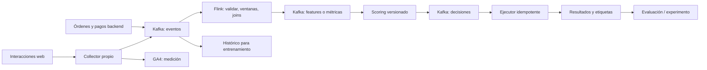

# Plan de estudio y trabajo · Arquitectura orientada a eventos

## El resultado que buscamos

Al terminar deberías poder tomar una necesidad de negocio, decidir si requiere streaming, elegir claves y contratos, construir productores y consumidores, procesar event time con Flink y servir un modelo con medición de su calidad. También deberías poder explicar qué pasa cuando un mensaje llega tarde, se repite o el proceso se cae.

No es una promesa de dominar sistemas distribuidos en cuatro meses: es un primer proyecto serio y una base para profundizar. Tu ventaja de partida es entender eventos de marketing, SQL, Python y validación de modelos. La parte nueva es convertir esa lógica en un sistema que mantiene estado y sigue funcionando con fallos.

## Ritmo y forma de trabajar

**16 semanas × 8 horas = 128 horas.** Distribución orientativa semanal: 2 h de conceptos y documentación, 4 h construyendo, 1 h rompiendo o midiendo el sistema, 1 h de explicación y bitácora. Con 4 horas semanales, hacer cada semana de la tabla en dos semanas calendario.

No se fija una fecha de inicio: semana 1 es la semana que ustedes elijan. Prerrequisitos: Python básico, SQL con `GROUP BY` y `JOIN`, terminal y Git. Java alcanza para ejecutar herramientas; escribir Java es una profundización posterior.

Trabajen de a dos alternando conductor y revisor cada 45 minutos. Una persona programa y la otra pregunta por contratos, fallos y datos; en la siguiente sesión intercambian. Cada semana termina con un pequeño entregable, una revisión y una explicación oral sin leer. Usen [BITACORA.md](BITACORA.md) para registrar lo hecho.

## Recorrido semanal

| Sem. | Horas | Pregunta y conceptos | Trabajo concreto | Criterio de salida |
|---:|---:|---|---|---|
| 1 | 8 | ¿Qué significa que algo ocurrió? Evento vs comando vs consulta; GA4 vs dominio; streaming vs batch | Leer el puente WILDFI. Hacer lab 00. Dibujar `page_view`, `OrderPlaced`, `PaymentConfirmed` y sus consumidores | Defender qué dato confirma una venta y por qué `dataLayer.push()` no implica persistencia |
| 2 | 8 | ¿Cómo viaja y se conserva un evento? Topics, particiones, claves, offsets, KRaft, replicación | Broker de laboratorio. Topic con 3 particiones. Producir claves repetidas; leer clave/partición/offset | Mostrar orden dentro de una partición y explicar por qué no hay orden global |
| 3 | 8 | ¿Cómo trabajan varios consumidores? Consumer groups, commits, rebalance, lag, replay | Dos consumidores del mismo grupo y uno de otro grupo. Pausar uno, observar asignación y lag | Explicar diferencia entre repartir trabajo y dar una copia lógica a otro servicio |
| 4 | 8 | ¿Cómo evita el negocio una compra doble? Contratos, JSON Schema/Avro, evolución, idempotencia, DLQ | Revisar contrato incluido. Probar duplicado con mismo ID y compra con otro ID pero mismo transaction_id | Demostrar ambos tipos de dedup; escribir política de retención y compatibilidad |
| 5 | 8 | ¿Qué es una tabla que cambia todo el tiempo? Dynamic tables y changelog de Flink | Hands on 01: exploración, dedup y `EXPLAIN` con el workshop | Mostrar el plan, la clave de estado y si la salida inserta o actualiza |
| 6 | 8 | ¿De qué reloj hablamos? Event time, processing time, watermark, TUMBLE/HOP, idle partitions | Ventanas del lab 01 y fixture local de Flink. Alterar timestamps y watermark | Predecir en qué ventana cae un evento y cuándo queda cerrado el resultado |
| 7 | 8 | ¿Qué versión del cliente conocíamos al comprar? Interval join y temporal join | Hands on 02: órdenes/pagos y dimensión CRM versionada | Explicar diferencia entre estado actual y estado a la hora del evento, y el costo de estado |
| 8 | 8 | ¿Qué pasa si se cae Flink? Estado, checkpoints, savepoints, backpressure | Guía de operación: matar un worker en ambiente propio, restaurar un job con checkpoint | Aportar evidencia de recuperación y sus límites; no basta que vuelva a correr desde cero |
| 9 | 8 | ¿Cómo llega una fila de entrenamiento a existir? Features point-in-time, leakage, train/serve skew | Hands on 03: inspeccionar generador, separar train/valid/test por tiempo, baseline y modelo | Explicar cada feature y demostrar que la etiqueta no está en la observación online |
| 10 | 8 | ¿Cómo transforma una probabilidad en decisión? Logística, costos, calibración, umbral | Servir el modelo congelado en Kafka, inspeccionar decisiones y correlacionarlas con etiquetas | Comparar Brier, precision/recall y costo contra baseline; justificar el umbral |
| 11 | 8 | ¿Cuándo aprender otra vez? Labels tardías, evaluación prequential, drift y promoción | Repetir con `--online-learning`; comparar tramos y calidad con modo congelado | Distinguir cambio de features, cambio de relación X→y y demora del feedback; no promover por accuracy sola |
| 12 | 8 | ¿Cómo conecta GTM con un producto de datos? Taxonomía, dataLayer, collector y doble destino | Hands on 04: plan de medición, normalización allowlist, GA4 vs backend de compra | Trazar un evento desde navegador a métrica, sin exponer credenciales de Kafka en el browser |
| 13 | 8 | ¿Cuándo es razonable activar? Timers, compra tardía, cancelaciones, consentimiento, frequency cap | Motor de marketing local y Kafka; fixture de checkout/compra tardía | Explicar las dos acciones y la cancelación; no activar sin consentimiento publicitario |
| 14 | 8 | ¿Funcionó la decisión para el negocio? Holdout experimental, atribución, uplift vs propensión | Diseñar A/B de asistencia con elegibles, unidad, ventana y métrica; sólo diseño sintético | Separar tasa de compra observada de efecto incremental; evitar mezclar con MMM |
| 15 | 8 | ¿Cómo se opera? SLO, lag, latencia, errores, estado, seguridad, costos | Instrumentar medición y ejecutar los escenarios de fallo de la guía | Reportar p50/p95 desde recepción hasta decisión, duplicados, DLQ y costo estimado |
| 16 | 8 | ¿Pueden defender una arquitectura? Alternativas y tradeoffs | Capstone: demo, contrato, pruebas, informe de decisiones y retrospectiva | Otra persona puede clonar, ejecutar y explicar los límites usando el README |

## Hitos de revisión

**Hito A, semana 4 — Un contrato confiable.** Entregar un diagrama, topic de tres particiones, dos grupos, contrato versionado y dedup de compra. Si no pueden explicar key/offset/group, repetir el ejercicio antes de pasar a Flink.

**Hito B, semana 8 — Un producto de datos continuo.** Entregar SQL, plan de ejecución, ventanas con watermark, un join con límite temporal y evidencia de recuperación. El estado de este repositorio incluye ejercicios preparados; la prueba de caída/restauración es una actividad a completar y registrar.

**Hito C, semana 11 — Un sistema que puntúa y se evalúa.** Entregar artefacto de modelo, contrato de features, decisiones con versión/umbral y reporte con etiquetas demoradas. Escribir una condición de rollback. El modo online es un experimento; debe superar un challenger evaluado antes de promocionarse.

**Hito D, semana 16 — Un caso de marketing defendible.** Entregar trazabilidad de medición, separación de compra backend, política de activación y experimento incremental. Comparar latencia, complejidad y costo con una alternativa batch de 15 minutos.

## Capstone propuesto

Una tienda sintética emite navegación y órdenes. Kafka conserva los contratos; Flink valida, agrega y enriquece. Un servicio de scoring emite una decisión versionada; un ejecutor idempotente registra la acción. Un flujo posterior de resultados permite evaluar calidad predictiva. Para marketing, un holdout aleatorio dentro de la población elegible estima el efecto de la asistencia.

El diagrama es el objetivo final. Los demos Python, Kafka y los SQL se entregan como etapas: consultar el informe de validación para saber cuáles se ejecutaron integrados.

## Cómo medir el progreso

Puntúen cada hito de 0 a 2 en cinco dimensiones: explicación, reproducibilidad, contrato/calidad, fallos/operación y decisión de negocio. **8/10 con ningún cero** es un criterio razonable para avanzar. Un pantallazo de un dashboard no reemplaza un input conocido y una salida verificable.

Antes de cada review, responder: ¿quién produce el dato?, ¿qué clave tiene?, ¿cuánto tiempo guardo estado?, ¿cómo reintento?, ¿qué pasa con el evento tardío?, ¿cómo sé que la decisión fue útil?, ¿qué complejidad eliminaría si la latencia tolerada fuera un día?

## Después de las 16 semanas

Elegir una profundización por vez: DataStream API y timers/CEP; Kafka Connect y CDC con transactional outbox; Schema Registry y Avro/Protobuf; lakehouse con Iceberg/Tableflow; serving asíncrono y feature stores; observabilidad con Prometheus/Grafana; Kafka Streams; seguridad TLS/SASL/ACL y despliegue Kubernetes. Tableflow/AWS es opcional, posterior al núcleo del workshop.

Las lecturas oficiales están en [FUENTES.md](docs/FUENTES.md), organizadas por etapa. No hace falta comprar cursos para completar el primer recorrido.
