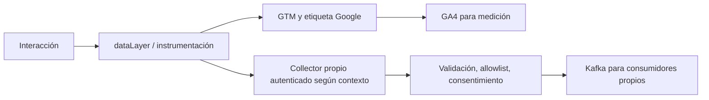

# De lo que conocías en WILDFI a arquitectura orientada a eventos

## La intuición primero

Cuando alguien agrega una zapatilla al carrito, sucedió algo que varios sistemas pueden necesitar conocer. Analytics quiere medir el funnel; recomendaciones quiere ajustar una sugerencia; operaciones quiere estimar demanda. La arquitectura orientada a eventos permite que esos consumidores reaccionen a un hecho sin que el productor tenga que conocer a cada uno.

Tu experiencia previa sirve para definir nombres, propiedades, contexto y calidad de medición. Lo nuevo es pensar además en persistencia, contratos, orden, duplicados, consistencia y fallos.

| Concepto conocido | Puente al mundo de eventos | Límite de la analogía |
|---|---|---|
| `dataLayer.push({event: ...})` | Instrumentar una interacción y adjuntar contexto | Es una estructura del navegador; por sí sola no es un log durable |
| Trigger de GTM | Seleccionar cuándo ejecutar una etiqueta | No equivale a un consumer group de Kafka |
| Evento y parámetros de GA4 | Contrato semántico de medición | Un evento de medición no certifica una transacción del backend |
| `client_id`, `user_id`, sesión | Identidad y claves de correlación | Un ID de navegador no siempre identifica una persona ni está disponible sin consentimiento |
| Reporte Realtime | Vista operacional de lo recibido | No implica que un modelo aprenda ni una acción se ejecute en ese instante |
| Exportación analítica | Histórico para BI, features y entrenamiento | Un reporte agregado no reemplaza un stream operacional con latencia controlada |
| Conversión atribuida a campaña | Una regla descriptiva de asignación de crédito | No estima por sí misma el efecto causal de la campaña |

## Tres eventos que parecen iguales, pero no lo son

`purchase` en el navegador describe lo que la implementación de medición reportó. `OrderPlaced` indica que el servicio aceptó una orden. `PaymentConfirmed` indica que el sistema de pagos confirmó el cobro. Pueden ocurrir en momentos diferentes; una página puede recargarse, bloquearse o nunca abrirse.

Para ingreso financiero, usar una fuente backend confiable y deduplicar por identidad de negocio, por ejemplo `transaction_id`. Para entender experiencia y funnels, la medición de navegador sigue siendo valiosa. Correlacionar ambos flujos permite detectar diferencias, sin asumir equivalencia.

**Evento:** `PaymentConfirmed` — informa un hecho pasado. **Comando:** `IssueRefund` — pide hacer algo y puede rechazarse. **Consulta:** `GetOrderStatus` — pide una lectura. No llamar “evento” a cualquier solicitud HTTP sin definir esa semántica.

## Dos destinos desde una misma instrumentación

Es una propuesta de integración. GA4 no entrega automáticamente cada hit a Kafka ni GTM reemplaza al broker. El collector propio es un componente que habría que implementar y operar; en este repositorio se incluye la función de normalización y los fixtures, no un collector desplegado.

El Measurement Protocol sirve para enviar datos **hacia GA4**, especialmente interacciones server-side/offline que complementan el tagging. No es una API para extraer el stream crudo de GA4 hacia Kafka. Su API secret debe permanecer en servidor. Recibir HTTP 2xx no prueba que GA4 haya validado e incorporado todo el payload: usar el mecanismo de validación de Google.

## Por qué Kafka y por qué Flink

Kafka conserva eventos en un log particionado y permite que consumidores independientes avancen con sus propios offsets. Elegir una key agrupa eventos relacionados en una partición; eso ayuda con el orden local, no crea un orden global entre particiones.

Flink mantiene cómputo y estado sobre streams: ventanas, agregaciones, joins y timers. Un watermark expresa un avance estimado en event time. No garantiza que no aparecerá un evento anterior; por eso la política de tardanza forma parte del producto de datos.

Para ML hay otra responsabilidad: entrenar y validar un modelo, publicarlo, servir predicciones y evaluar resultados cuando llega la etiqueta. Ni Kafka ni Flink convierten automáticamente un flujo en un algoritmo de aprendizaje.

## Cuándo sí conviene streaming

Tiene sentido cuando una decisión debe tomarse antes de que pierda valor, hay varios consumidores independientes o se necesita replay continuo. Ejemplos: bloquear una operación de riesgo en segundos, ayudar durante un checkout o detectar una falla operativa.

Una tabla semanal para MMM o un reporte diario pueden resolverse bien en batch. Menor latencia de ingestión no resuelve confusión, identificación causal o falta de ground truth. Uplift, atribución y MMM responden preguntas distintas y necesitan diseños/datos diferentes.

Lecturas: [eventos GA4](https://developers.google.com/analytics/devguides/collection/ga4/events), [dataLayer](https://developers.google.com/tag-platform/tag-manager/datalayer), [Measurement Protocol](https://developers.google.com/analytics/devguides/collection/protocol/ga4), [Kafka introduction](https://kafka.apache.org/intro/). Revisión del material: 29/10/2026.
